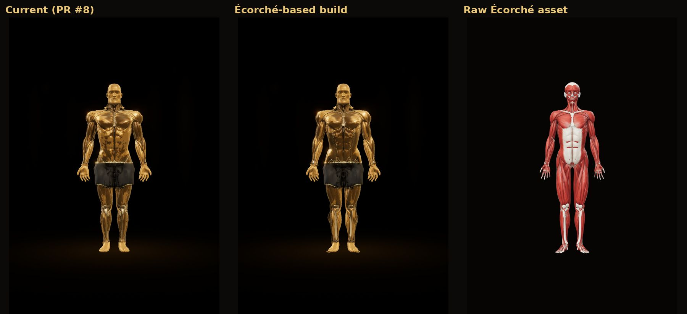
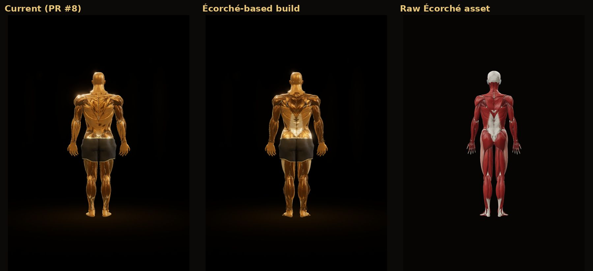
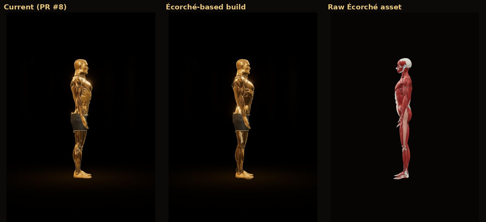
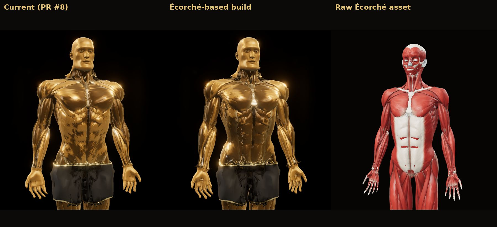
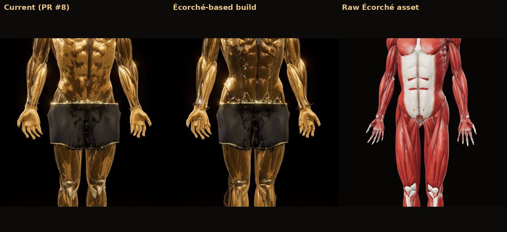
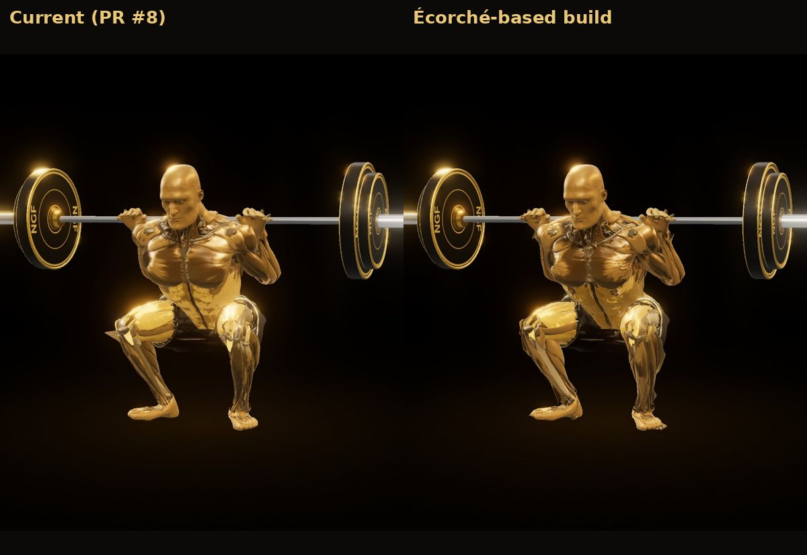

# Evaluation: Écorché as the anatomy source for the athlete

Status: **evaluation only.** Nothing in the app or in `public/anatomy/athlete.*` was replaced. The Écorché-based build is
a separate file (`public/anatomy/athlete-eco.*`, not committed) made with the same pipeline, and both builds were
rendered with the same renderer, lights and cameras.

## 1. What the asset is

Écorché (github.com/Charleeh/ecorche, commit 320805e), cloned into a separate workspace:

- 634 named meshes: 198 bones, 159 deep and 203 superficial muscles, cartilage, teeth and eyes; 985k triangles.
- **No skin, no rig, no poses.** The head is facial muscles (lidless eyes, teeth), not a face.
- Source data: **the same BodyParts3D subject we already use** (version 4.0), plus Z-Anatomy for the latissimus dorsi,
  rectus abdominis, internal oblique, transversus abdominis, back muscles and the face muscles.

(The Innerscene rigged base mesh could not be inspected: the environment's network policy blocks `innerscene.com`.)

## 2. Is it a genuine improvement? Partly.

**Muscle detail.** Not higher overall: many muscles have fewer triangles than ours (gluteus maximus 1,094; deltoid parts
584-984). Most of its triangles are the skeleton (255k), the rebuilt external obliques (47.6k each) and the Z-Anatomy
rectus abdominis (16k each).

**Mesh quality.** Yes, in specific places:

- the external oblique and serratus anterior are single smooth surfaces (in raw BodyParts3D they are overlapping fibre
  bundles, a direct cause of the blotchy, "feathered" flanks on our athlete);
- the Z-Anatomy rectus abdominis gives a crisper six-pack, and the lats and lower back read more clearly;
- crossings between the two datasets are fixed, and left and right are exact mirrors.

**Body proportions.** No change: it is the same average-build subject. The athletic proportions come from our own
morph in both builds.

## 3. Integration test

`ECORCHE=<path to ecorche.glb> npx tsx scripts/anatomy/build-athlete.mts …` takes every muscle, tendon and bone from
Écorché, welded and fitted onto our BodyParts3D skeleton by rotation, scale and offset (Horn's method: 87 matching bones,
**1.16 cm average residual**, 0.48° rotation; the remaining misfit is genuine shape difference between BodyParts3D
4.0 and 3.0). Everything else is the same pipeline: the skeleton gives the joints (identical rig), the skin gives the
hands, feet, fascia and shorts, the MakeHuman face, athletic proportions, fitted shorts, skin weights, gold material and
per-muscle glow (the muscle names match, so the glow works unchanged). Écorché's own tendon tint replaces our heuristic,
and its white aponeurosis over the six-pack is left out so the abs can show and glow.

Problems found and fixed during the test (the fixes apply to both builds):

| Problem | Cause | Fix |
|---|---|---|
| Long sliver from armpit to hip in the squat | Z-Anatomy latissimus runs into the armpit; its arm-to-torso weight change was a narrow band | Weights spread over the whole latissimus so it stretches evenly |
| Fragments on the front of the shorts | Fascia over the groin kept the scanned skin's shape in front of the fabric; folded fabric showed as see-through holes | All fascia inside the shorts band removed; the fabric is drawn two-sided |
| Pieces of abdominal muscle poking through | The 1.2 cm misfit put them just outside the fabric | Anatomy less than 1.5 cm outside the fabric inside the band counts as covered (never the forearms) |

Verified by casting rays from the front over the groin: in the current build the only non-fabric first hits are now the
legitimate dark gap between the thighs below the hem and the inner-thigh muscles.

### Results (same renderer and cameras: current | Écorché-based | raw Écorché)

| | |
|---|---|
|  |  |
|  |  |
|  |  |

Animated squat rep, both builds side by side: `renders/ecorche-eval/squat-rep.gif`. Also: face, squat bottom from the
front and rear, glow off and on.

**Better** in the Écorché-based build: abs, flanks, lats and lower back; hamstrings and calves.
**Worse:** a few more remnants at the waistband edge than the current build; 60% heavier (~654k triangles, 16.7 MB vs
~410k, 10.5 MB).
**Unchanged** (neither source fixes it): the face (MakeHuman in both), the jagged edge where the waistband and hems meet
the muscles, deformation in deep flexion (linear blend skinning without corrective shapes), and the overall gap to
the painted look of the reference.

## 4. Verdict

Écorché is a **real but targeted** improvement in the muscles the app highlights most (abs, obliques, lats), and its
integration now animates as cleanly as the current build. It is not a different class of model and will not by itself
reach the reference. Recommendation: adopt it for the torso and back once the waistband edge is cleaned up, and budget for
the extra weight on phones (the mobile index buffer brings it to ~294k triangles).

## 5. Player controls (both builds)

Checked in Chromium by `scripts/anatomy/preview/controls-test.mjs`: play/pause, 360° drag rotation, mouse-wheel zoom,
**two-finger pinch zoom (new)**, front/side/rear presets, slow motion (0.35×) and full speed. All pass. Not tested on a
physical phone.

## 6. Licensing (CC BY-SA 4.0, checked against the licence text in the repository; not legal advice)

- **Commercial use is allowed.**
- **Attribution (Section 3(a)):** keep the creator credit and notices, say that the material was modified, and include the
  licence or its URL. Écorché's suggested credit: "Écorché (github.com/Charleeh/ecorche), CC BY-SA 4.0. Based on
  BodyParts3D, © The Database Center for Life Science, CC BY 4.0, and Z-Anatomy by Gauthier Kervyn, CC BY-SA 4.0." This
  belongs in the app's credits/licences screen and in `public/anatomy/LICENSE.md`.
- **ShareAlike (Section 3(b)):** our athlete mesh built from it is Adapted Material and must be licensed CC BY-SA 4.0
  (or a compatible licence). This covers the mesh data, not the app's code.
- **No downstream restrictions (Sections 2(a)(5)(C) and 3(b)(3)):** we may not apply "Effective Technological
  Measures" that restrict recipients' rights to the mesh. Whether App Store / Play distribution counts as such a
  measure is an open question for counsel before release.
- The current asset already carries a similar share-alike obligation (BodyParts3D 3.0 data, CC BY-SA 2.1 JP). Écorché
  notes BodyParts3D is now published under CC BY 4.0: a rebuild from the current BodyParts3D release *without* the
  Z-Anatomy pieces would need attribution only.
- MakeHuman (head): CC0. CC0 content combines freely with CC BY-SA.
