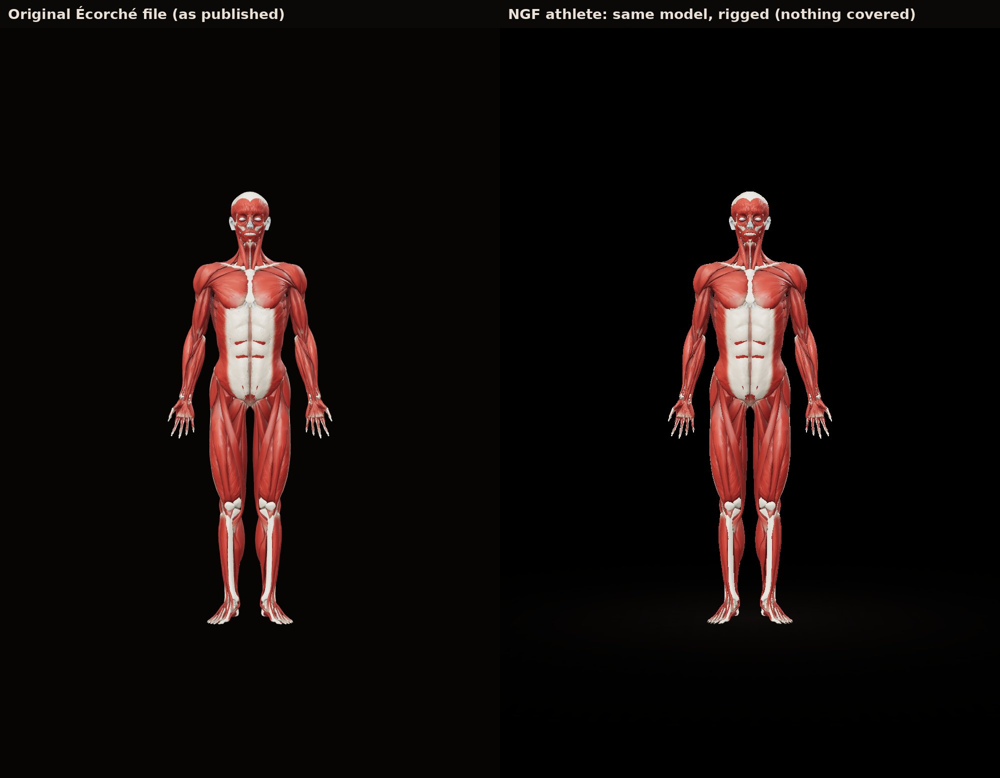
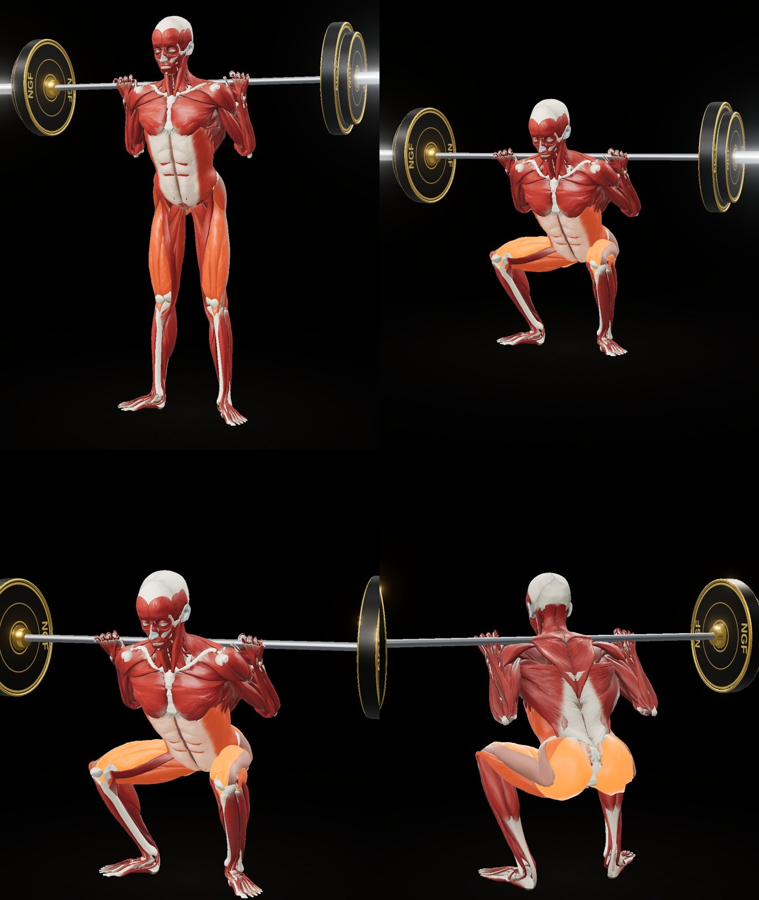

# The raw Écorché athlete

Status: **experimental, awaiting the owner's approval of the squat.** Built inside draft PR #8. Nothing in the app was
switched over to it, and every existing exercise demonstration is unchanged.

The owner chose the original, unaltered Écorché model (github.com/Charleeh/ecorche): red muscle, white tendons and
aponeuroses, ivory bone, its own head. This build keeps that model as published and only adds what is needed for it to
perform exercises.

## What is kept exactly as published

- **Every mesh** (634: 198 bones, 42 cartilages, 28 teeth, 4 eye parts, 362 muscles), with its geometry, triangle
  count and vertex order. Vertices are only welded where the file splits them along colour or normal seams (127 of
  486,005).
- **Proportions**: one uniform scale (×1.074, to the app's 183 cm figure), a 0.48° rotation and an offset, fitted on
  87 bones. Nothing is inflated, sculpted or morphed.
- **Colours**: the file's own vertex-colour bytes (they include its baked shading), drawn as they are.
- **Materials**: the file's two materials (non-metallic; roughness 0.48 for muscle, 0.62 for bone, cartilage, teeth
  and eyes), under the same studio lighting as the reference renders (ACES tone mapping, room environment at 0.6, one
  warm key light, one white rim light).
- **Head**: Écorché's own skull, facial muscles, eyes and teeth. No MakeHuman head, no scanned skin, no fascia.
- **Nothing covered**: no shorts and nothing cut away. The pelvis, lower abdomen, glutes and hips look exactly like the
  published model (the owner's reference images), and every glute and hip muscle can glow.

## What is added

- **Rig**: joints measured from the BodyParts3D skeleton, which is the same subject as Écorché. They are stored with
  the asset (`bind` in `athlete-raw.json`), so this figure keeps its own, unwidened shoulders. Bones move rigidly.
  Muscles are skinned with blended weights, and every part may only follow the bones of its own limb (a thigh muscle
  can never follow the hand hanging beside it). The limb comes from the muscle's region, or for unlabelled parts from
  where the whole mesh lies, and is stored with the asset (`limb` block). The motion comes from the app's existing
  exercise engine.
- **Hip bones under the glutes** follow the muscles over them instead of moving rigidly (only bone that is buried under
  muscle at rest, blended smoothly into the rigid bone around it). Rigid, the femur heads, greater trochanters and
  sitting bones came through the stretched glutes at the bottom of a squat as grey patches. The sacrum and the crest of
  the pelvis, which are seen at rest, stay rigid.
- **Muscle labels** for the glow, from the muscle names. Worked muscles brighten towards a warm orange (primary
  muscles fully, secondary ones softer). All other muscles keep their own red.
- **Shorts (off)**: fitted black trunks can still be built for this figure (`ECORCHE_SHORTS=1`), but by default it is
  shown as published, with nothing covered.

## Build

```bash
ECORCHE=/path/to/ecorche/model/ecorche.glb ECORCHE_USE=raw \
  npx tsx scripts/anatomy/build-athlete.mts <BodyParts3D STL folder> <MakeHuman data folder>
ATHLETE=public/anatomy/athlete-raw npx tsx scripts/anatomy/reweight.mts
```

The preview shows it with `?asset=athlete-raw` (`scripts/anatomy/preview/build.sh`, then open
`.anatomy-preview/index.html?asset=athlete-raw`).

Size: 984k triangles, 33 MB with the mobile index buffer (443k triangles). That is twice the gold athlete;
compressing it (Draco or meshopt) or dropping fully hidden deep structures would be the next step before shipping it to
phones. Not tested on a phone.

## Verification

Renders are in `renders/raw-ecorche/`, all from the actual model:

- **Same character** (`compare-*.jpg`): the original file and the new athlete, side by side at the same size and
  camera. Views: front, side, rear, face from two angles, torso, back, and the hips from the front, rear and side.
- **Moving squat** (`squat-rep.gif`): one full repetition.
- **Poses**:
  - `squat-views.jpg`: the squat top, plus the bottom from the side, front and rear;
  - `other-poses.jpg`: walking lunge, Romanian deadlift and run.
- **Close-ups**:
  - `squat-bottom-closeups.jpg`: the glutes from behind and from the side, the front of the hips, and the knee, at
    the bottom of the squat;
  - `hips-and-legs.jpg`: the pelvis from the front, side and rear, and the legs.
- **Glow** (`glow-off-on.jpg`, `glow-standing-off-on.jpg`): off and on, at the bottom of the squat and standing.




Problems found and fixed on the way:

| Problem | Cause | Fix |
|---|---|---|
| Red patches through the white abdominal sheath | When the shorts trimmed a muscle, its vertex colours were not re-indexed with it | Colours travel with every vertex through every cut |
| Long strands from the hands to the hips when the bar is raised | Thigh-muscle vertices near the resting hand were bound to the hand | Each labelled muscle follows only its own limb |
| Glute triangles through the shorts in the squat | Large triangles straddling the trim line reached deep under the fabric | Exact cut along the line, not whole triangles |
| Black spikes above the waistband | The fabric's clearance pass lifted the edge along upward normals | The edge band is held where the cut puts it |
| Strands from the hands to the hips (again, after the first fix) | Small unlabelled thigh muscles beside the resting hand | Every part gets a limb from where the whole mesh lies |
| Halo around the white skull | Bloom caught the bright bone | Bloom only above the glow's brightness |
| Grey bone patches through the glutes at the bottom of the squat (once the shorts were gone) | The hip bones moved rigidly while the muscle over them blended | Buried hip bone follows the muscle over it |
| White bone shards under the glutes (first version of that fix) | Buried and rigid bone vertices side by side | The switch is blended smoothly over the bone surface |

Player controls (360° drag rotation while it moves, pinch and wheel zoom, front, side and rear presets, slow motion,
play and pause) are checked by `scripts/anatomy/preview/controls-test.mjs` against this asset.

## Known limits

- **Deformation** is linear blend skinning, as for the gold athlete. Deep hip and knee flexion compresses the muscles
  around the joint instead of bulging them, and there are no corrective shapes.
- **Knee at full depth**: the patella and tendons crowd together at the front of the knee, the same skinning limit.
- **Between the glutes**: the sacrum, coccyx and the white tissue of the pelvic floor show, as on the published model.

## Licence: CC BY-SA 4.0 (summary for the project, not legal advice)

The asset (`public/anatomy/athlete-raw.bin` and `.json`) is an adaptation of Écorché, which is licensed CC BY-SA 4.0.
Écorché is built on BodyParts3D (© The Database Center for Life Science, CC BY 4.0) and Z-Anatomy (Gauthier Kervyn,
CC BY-SA 4.0).

**Commercial use is allowed** (Section 2(a)(1)), on these conditions.

### Attribution (Section 3(a))

Wherever the athlete is distributed (the app's credits or licences screen, the store listing or website, and the asset
files themselves), keep:

- the credit to the creators: "Écorché (github.com/Charleeh/ecorche), CC BY-SA 4.0. Based on BodyParts3D, © The
  Database Center for Life Science, CC BY 4.0, and Z-Anatomy by Gauthier Kervyn, CC BY-SA 4.0.";
- the notice that the material is licensed under CC BY-SA 4.0, with the licence text or its URL
  (https://creativecommons.org/licenses/by-sa/4.0/);
- the disclaimer of warranties notice;
- a link to the source, where reasonably practicable;
- a statement that it was modified and how ("rigged for animation, scaled, muscle labels added").

This may be done in any reasonable manner for the medium (Section 3(a)(2)), for example a Licences screen in the app.

### ShareAlike (Section 3(b))

- The adapted athlete mesh must itself be licensed **CC BY-SA 4.0** (or a compatible later version), and recipients
  must be told so (`public/anatomy/LICENSE.md`).
- This covers the mesh data. Whether it extends to the app code that displays it is a question for counsel; the usual
  reading is that a program using a separate data file is not an adaptation of it.

### No downstream restrictions (Sections 2(a)(5)(C) and 3(b)(3))

- No additional terms, and no technological measures, may restrict what recipients can do with the mesh under the
  licence.
- App Store / Google Play distribution applies encryption or DRM to the whole app package. Whether that counts as such
  a measure for an embedded CC BY-SA asset is an open question for counsel. A common mitigation is to publish the
  adapted mesh files openly as well (for example in a public repository under CC BY-SA 4.0), so recipients can always
  get them without restriction.

### Other notes

- No trademark or endorsement: the credit must not suggest the authors endorse the app (Section 2(b) and 3(a)(1)(A)).
- Écorché also lists MIT-licensed code (its viewer and tools). None of it is used here.
- This is a summary of the licence text for the project, **not legal clearance**. Have it reviewed before release.
