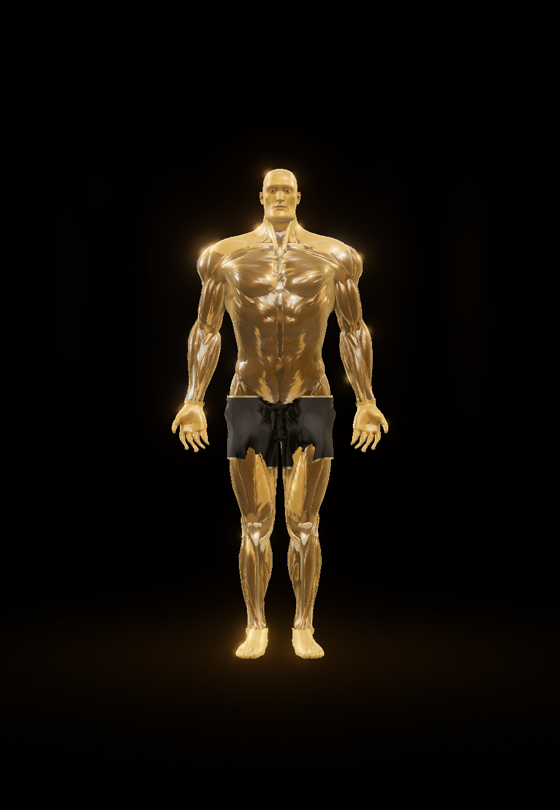
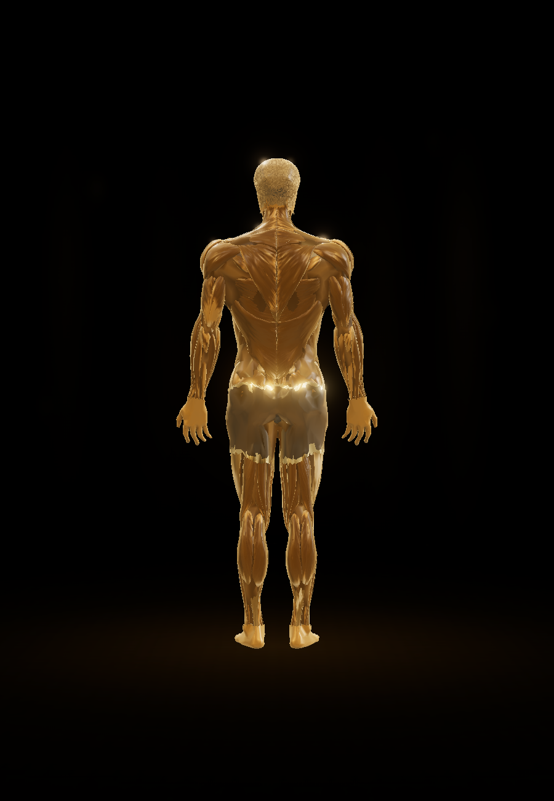
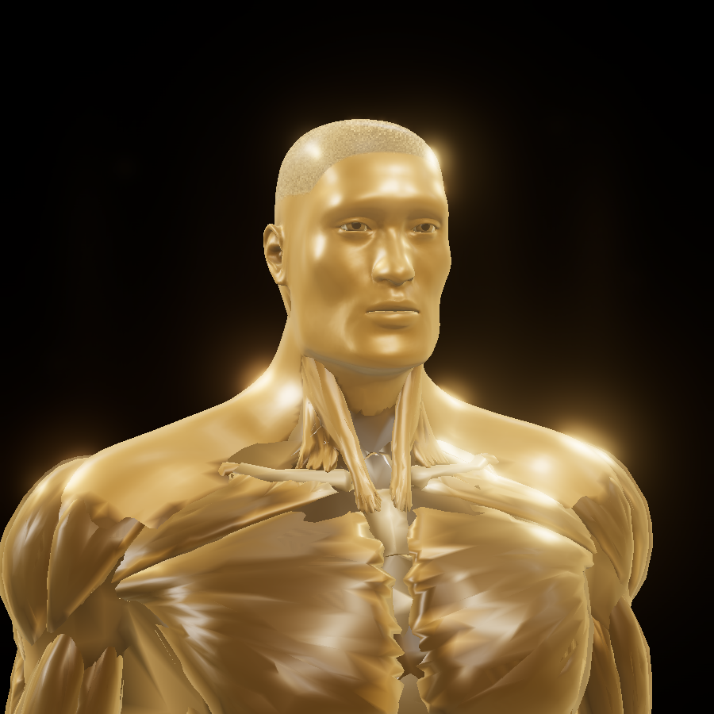
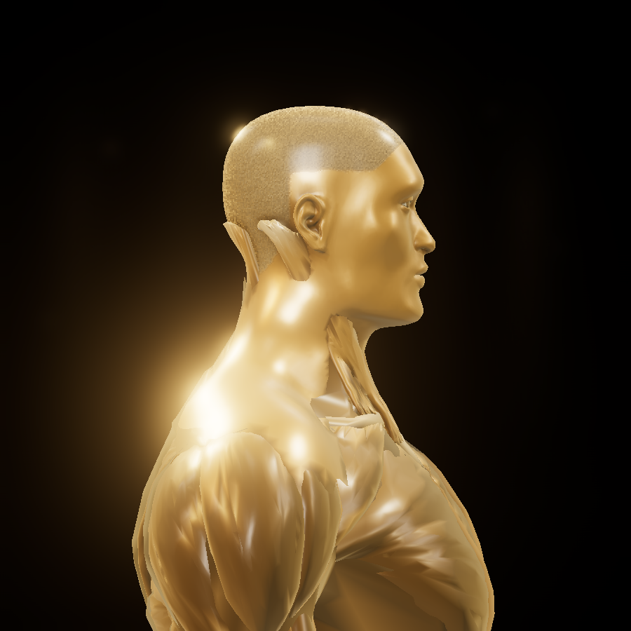
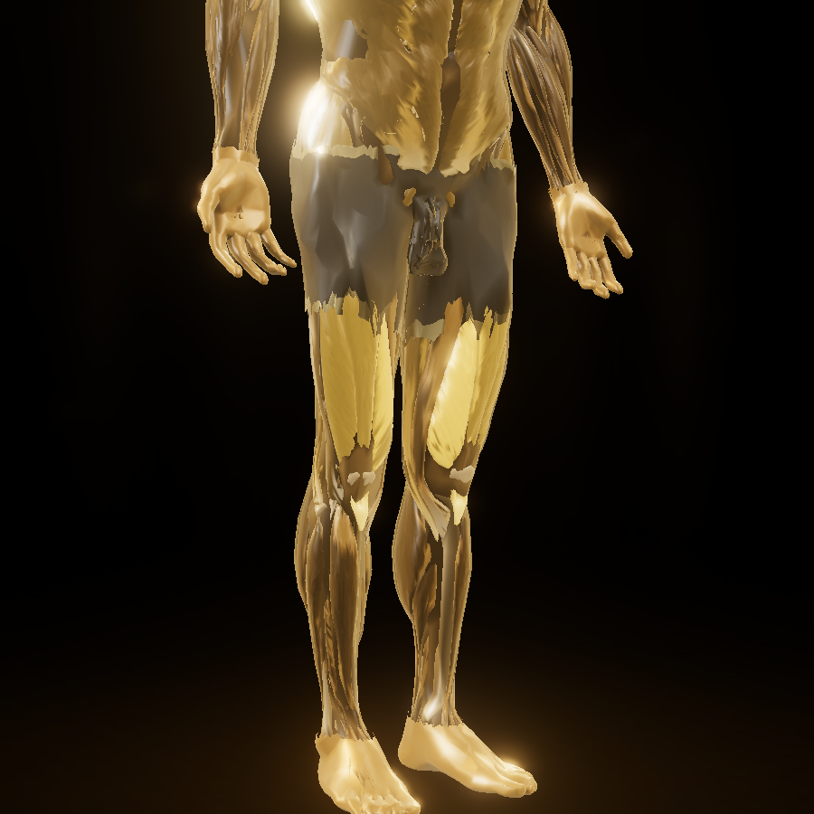
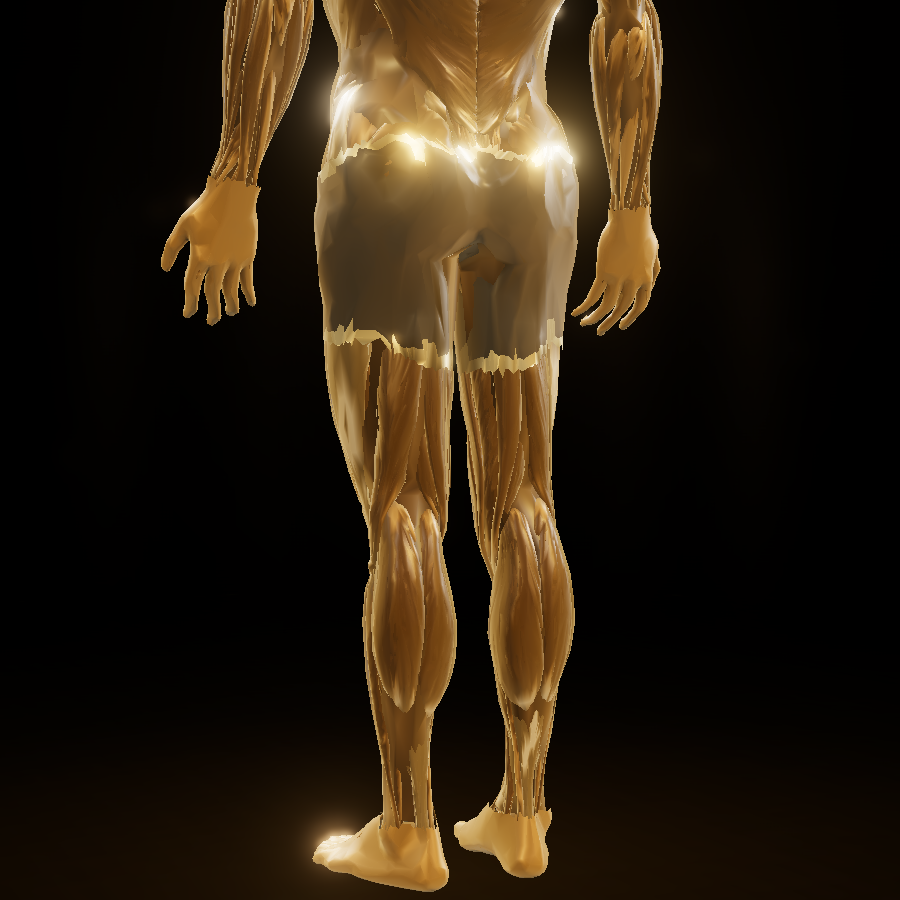
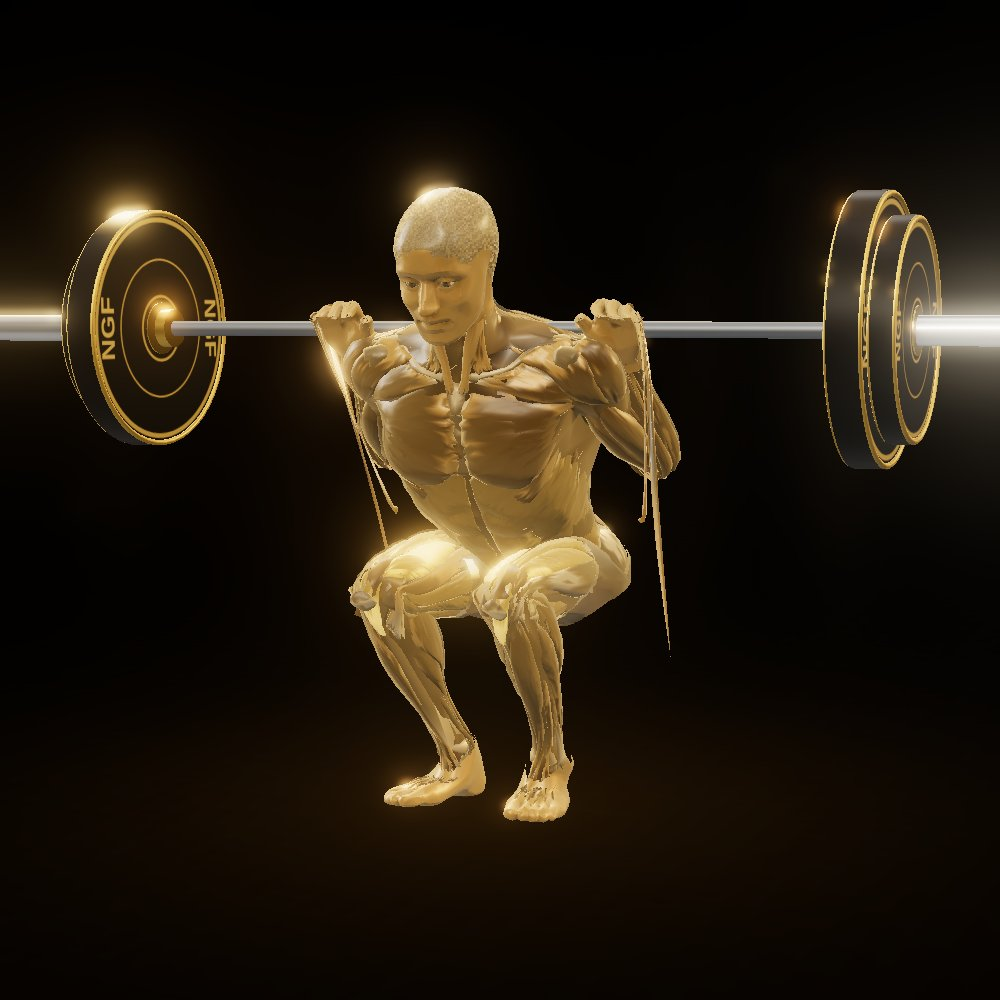
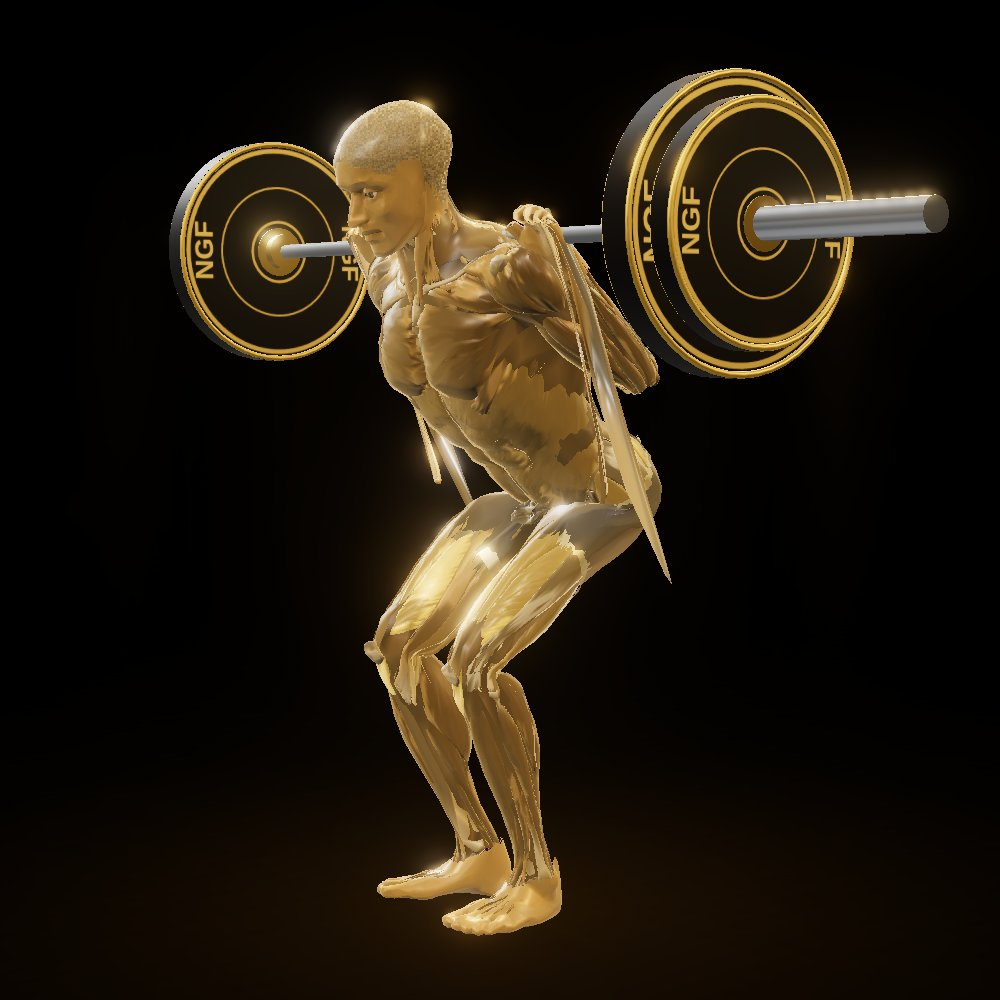

# Gold anatomical athlete (work in progress)

Status: **not approved, not final.** A code-generated 3D anatomical athlete for the exercise demonstrations, built as a
technical checkpoint (one exercise, the barbell back squat). The existing 2D demonstrations are unchanged and remain
what the app uses; nothing here is wired into the app's pages yet.

Renders below are from the actual model (headless Chromium, WebGL via SwiftShader), not concept art.

| | |
|---|---|
|  |  |
|  |  |
|  |  |
|  |  |

## How the character is made

The mesh is built offline from **BodyParts3D** (open anatomical data from medical imaging, CC BY-SA 2.1 JP, see
`public/anatomy/LICENSE.md`); the **head, face, ears, neck and eyes** come from the **MakeHuman** base mesh and shape
targets (CC0) — and saved as `public/anatomy/athlete.bin` + `athlete.json` (~440k triangles, 11.6 MB).

| Concern | Where |
|---|---|
| **Head / face**: MakeHuman base mesh + face recipe (targets and weights), cut below the neck, Catmull-Clark smoothing, fitted by eyes and chin-to-crown height | `scripts/anatomy/makehuman-head.ts` (`FACE_RECIPE`) |
| Which anatomy parts are used, and each part's glow region and kind (muscle / bone / tendon) | `scripts/anatomy/bp3d-regions.ts` |
| Building the athlete: loading, simplification, joint measurement, muscles, bones, tendons, eyes, face/hands/feet skin, fascia layer, pelvic cover, **shorts**, **athletic proportions** (upper-body morph, crown), **hair mask**, six-pack carving | `scripts/anatomy/build-athlete.mts` |
| Smooth envelopes over the anatomy (voxel field, closing, surface nets): the shorts and the fascia layer | `scripts/anatomy/shorts-envelope.ts` |
| **Skin weights** (rigging) and baked ambient occlusion | `scripts/anatomy/weights.ts`, `scripts/anatomy/reweight.mts` |
| Joint centres measured from the skeleton (generated) | `src/lib/anatomy3d/athlete-bind.generated.ts`, `bind.ts` |
| Loading the mesh, the skeleton | `src/lib/anatomy3d/mesh.ts` |
| **Rig**: 2D motion frame → 3D joints (IK for elbows/knees), bone posing and stretching | `src/lib/anatomy3d/rig.ts` |
| Hand grip (finger curl morph) | `src/lib/anatomy3d/grip.ts` |
| **Material / glow shader**: satin gold, fibre bump, tendon ends, bone, eyes, hair, shorts, fascia, per-muscle emissive glow, AO | `src/lib/anatomy3d/material.ts` |
| Which muscles glow per exercise (all catalogue exercises) | `src/lib/anatomy3d/muscle-map.ts` (+ `tests/unit/anatomy-muscle-map.test.ts`) |
| Glow timing through each rep (effort curve) | `src/lib/anatomy3d/effort.ts` |
| Scene, lights, bloom, backdrop | `src/lib/anatomy3d/scene.ts` |
| Equipment (barbell with NGF plates, rack, benches, machines, cables…) | `src/lib/anatomy3d/equipment.ts` |
| Player: playback, speed, cameras, glow toggle, stills | `src/lib/anatomy3d/player.ts` |
| Stand-alone squat preview page (reference layout) and review renders | `scripts/anatomy/preview/` |

Rebuild (needs the BodyParts3D STL folder, ~0.5 GB, not checked in):

```bash
git clone --filter=blob:none https://github.com/Kevin-Mattheus-Moerman/BodyParts3D /tmp/bp3d   # then check out the STLs used
git clone --filter=blob:none https://github.com/makehumancommunity/makehuman /tmp/mh            # then check out base.obj + the targets in FACE_RECIPE
git clone https://github.com/Charleeh/ecorche /tmp/ecorche                                       # commit 320805e; model/ecorche.glb
ECORCHE=/tmp/ecorche/model/ecorche.glb ECORCHE_USE=torso \
  npx tsx scripts/anatomy/build-athlete.mts /tmp/bp3d/assets/BodyParts3D_data /tmp/mh/makehuman/data
npx tsx scripts/anatomy/reweight.mts          # skin weights + ambient occlusion (seconds)
bash scripts/anatomy/preview/build.sh          # .anatomy-preview/index.html
```

## Known problems (honest list)

Compared with the owner's reference image (the gold anatomical barbell-squat illustration):

- **Face**: MakeHuman head (CC0), now at true scale for the body height. It still reads as a smooth mannequin: no fine
  facial anatomy, eyebrows or eyelashes, and the eyes are simple shaded spheres.
- **Shorts**: a smooth fitted envelope over the hip and thigh muscles (not cut from the scanned skin), opaque over the
  groin, separate leg tubes below a crotch gusset, skinned to the pelvis and thighs and checked in squat, lunge, hinge
  and run poses. In front views a narrow dark gap shows between the legs.
- **Neck base**: the cut where the MakeHuman neck meets the trapezius is visible in close-ups.
- **Deformation**: linear blend skinning without corrective shapes, so deep hip and shoulder flexion still pinches.
- **Look**: real-time WebGL; the reference is a painted render. It will not be pixel-identical.
- **Size**: ~493k triangles, 15.4 MB; a 45% mobile index buffer exists, but nothing has been measured on a phone.
- **Knees**: a small flap of BodyParts3D leg muscle shows at the knee in deep flexion.
- **Sources**: chest, abdomen and back muscles from Écorché (CC BY-SA 4.0), everything else from BodyParts3D 3.0; the
  whole mesh is therefore CC BY-SA 4.0 (see `public/anatomy/LICENSE.md` and `ECORCHE_EVALUATION.md`).
- Only the squat has been checked visually in depth; the other exercises and the 143 planned new exercises are not done.

Player controls (play/pause, 360° drag, wheel and pinch zoom, camera presets, slow motion) are checked by
`scripts/anatomy/preview/controls-test.mjs`.
