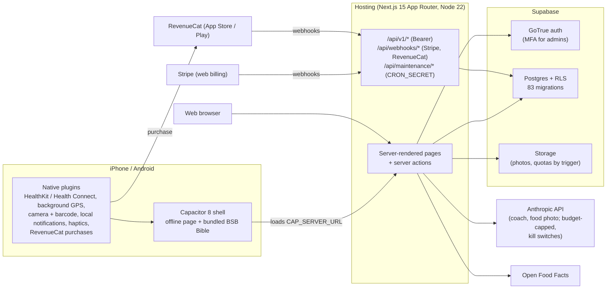

# External developer handoff and scope

For a contractor or agency picking up the remaining engineering work. Read MASTER_ENGINEERING_REPORT.md first, then
BUG_FIX_REGISTER.md (open items O-01..O-20 with files, repro steps and hours).

## Architecture



Key directories: `src/app` (routes), `src/components`, `src/server` (actions, services, auth, rate limits),
`src/lib` (domain logic, native bridges, billing, AI), `supabase/migrations`, `tests/unit`, `tests/integration`,
`e2e` (Playwright), `ios/`, `android/`, `native-shell/`, `.github/workflows`.

## Setup

```bash
nvm use            # Node 22 (.nvmrc; package.json engines)
npm ci
cp .env.example .env.local   # 19 variables documented; local Supabase values come from `npx supabase status`
npx supabase start           # needs Docker
npx supabase db reset        # applies all migrations + seed
npm run dev                  # http://localhost:3000
```

Paid services are **not** needed locally: AI and food lookups are mocked in tests, Stripe and RevenueCat use stand-ins.
Never use production keys locally.

## Test commands

| Command | What | Needs |
|---|---|---|
| `npm run typecheck` / `npm run lint` | TypeScript, ESLint | — |
| `npm run test:unit` | ~4,900 unit tests (jsdom) | — |
| `npm run test:integration` | Real-database tests: RLS, billing, consents, quotas | local Supabase running (suites skip if it isn't — O-19) |
| `npm run build && npm start` then `npx playwright test --project mobile` | Browser suite at phone size | Start the server with `ANTHROPIC_API_KEY=e2e-test-key ANTHROPIC_BASE_URL=http://127.0.0.1:<A> OFF_API_BASE_URL=http://127.0.0.1:<O>` and run Playwright with `E2E_BASE_URL`, `E2E_ANTHROPIC_MOCK_PORT=<A>`, `E2E_OFF_MOCK_PORT=<O>`, or AI tests fail falsely |
| `bash scripts/bundle-sql.sh` | Regenerate `supabase/setup-all.sql` after a migration | — |
| GitHub: CI, iOS, Android APK workflows | Same checks + Xcode archive/Simulator, APK compile | push to `release/**` or manual dispatch |

Rules: never skip or weaken a test; every migration gets an integration test; RLS is on for every table (a catalog
test enforces it).

## Scoped work and estimates

Hours add up the per-item estimates in BUG_FIX_REGISTER.md, for an experienced engineer familiar with the stack; ranges reflect device-testing uncertainty.

| Package | Items | Skill | Hours | Blocks |
|---|---|---|---|---|
| A. Native GPS reliability | O-01 persist locked-screen fixes to disk; O-03 orphaned watcher; O-02 wording after tests | iOS/Capacitor | 16–31 | Launch (App Review risk) |
| B. Notifications and alarms | O-04 wake-reminder wording, Android exact alarm, snooze; O-07 back button, reminder sync order | Mobile | 7–15 | No |
| C. Universal / app links | O-05 associated domains, `.well-known` files, auth-link routing | Mobile + web | 6–10 | No |
| D. Android polish | O-06 edge-to-edge insets; Play policy forms support | Android | 4–8 | Android launch |
| E. Billing robustness | O-08 grant-expiry recompute; O-09 replay lost refund/dispute events; O-10 one transaction per account | Payments | 12–23 | Paid subscriptions (recommended) |
| F. Deploy migrations to hosted Supabase | O-16 verify `storage.objects` triggers on a staging project; fallback if refused | Supabase/DB | 3–6 | TestFlight if hosted Supabase refuses the triggers; otherwise launch |
| G. Performance | O-12 parallelise workout finish reads; O-17 budget lock, policy helpers; production load test | Backend/DB | 9–18 | No (before ~1k actives) |
| H. Small reliability items | O-11, O-13, O-14, O-15, O-18, O-19, O-20 | Full-stack | 11–17 | No |
| I. Device test support | Fix whatever IPHONE/ANDROID_DEVICE_TESTING finds | Mobile | 8–20 (contingency) | TestFlight→launch |
| J. Release engineering | Signing, TestFlight upload pipeline, production env setup with the owner | iOS + DevOps | 6–10 | TestFlight |
| **Total** | | | **82–158** | |

Minimum to launch on iOS with paid subscriptions: A, E, F, I, J ≈ **45–90 hours**.
