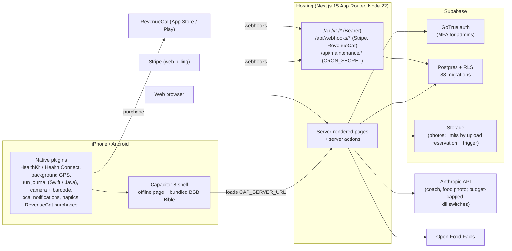

# External developer handoff and scope

For a contractor or agency picking up the remaining engineering work. Read MASTER_ENGINEERING_REPORT.md first, then
BUG_FIX_REGISTER.md (open items O-01..O-20 with files, repro steps and hours).

## Architecture



Key directories: `src/app` (routes), `src/components`, `src/server` (actions, services, auth, rate limits),
`src/lib` (domain logic, native bridges, billing, AI), `supabase/migrations`, `tests/unit`, `tests/integration`,
`e2e` (Playwright), `ios/`, `android/`, `native-shell/`, `.github/workflows`.

## Setup

```bash
nvm use            # Node 22 (.nvmrc; package.json engines)
npm ci
npm run setup                # or by hand: cp .env.example .env.local (every variable documented); local keys from `npx supabase status`
npx supabase start           # needs Docker
npx supabase db reset        # applies all migrations + seed
npm run dev                  # http://localhost:3000
```

Paid services are **not** needed locally: AI and food lookups are mocked in tests, Stripe and RevenueCat use stand-ins.
Never use production keys locally.

## Test commands

| Command | What | Needs |
|---|---|---|
| `npm run typecheck` / `npm run lint` | TypeScript, ESLint | — |
| `npm run test:unit` | ~4,900 unit tests (jsdom) | — |
| `npm run test:integration` | Real-database tests: RLS, billing, consents, quotas | local Supabase running (`REQUIRE_TEST_STACK=1` makes a missing stack fail — O-19) |
| `swift test --package-path ios/RunJournalCore` / `cd android && ./gradlew testDebugUnitTest` | Native run-journal store tests (XCTest, JUnit) | macOS with Xcode / JDK 21 + Android SDK (both run in the GitHub workflows) |
| `npm run build && npm start` then `npx playwright test --project mobile` | Browser suite at phone size | Start the server with `ANTHROPIC_API_KEY=e2e-test-key ANTHROPIC_BASE_URL=http://127.0.0.1:<A> OFF_API_BASE_URL=http://127.0.0.1:<O>` and run Playwright with `E2E_BASE_URL`, `E2E_ANTHROPIC_MOCK_PORT=<A>`, `E2E_OFF_MOCK_PORT=<O>`, or AI tests fail falsely |
| `bash scripts/bundle-sql.sh` | Regenerate `supabase/setup-all.sql` after a migration | — |
| GitHub: CI, iOS, Android APK workflows | Same checks + Xcode archive/Simulator, APK compile | push to `release/**` or manual dispatch |

Rules: never skip or weaken a test; every migration gets an integration test; RLS is on for every table (a catalog
test enforces it).

## Scoped work and estimates

All code work in the original scope (O-01 to O-20) and the third round (T-01 to T-26: native GPS persistence in Swift
and Java, billing at volume, trigger-free photo limits) is done, with tests (BUG_FIX_REGISTER.md). What remains needs a
phone, an account or a hosted service. It is run as an AI-assisted engagement: Claude implements, the consultants
direct, verify on real hardware and accounts, and review.

- **Agenda, parallel tracks and hours:** `docs/engagement/ENGAGEMENT_AGENDA.md`:
  - iOS launch with paid subscriptions: **25.5–41.5 h** ($9,818–$15,978 at $385/h);
  - with Android: 29–47 h ($11,165–$18,095).
- **Ready-to-paste prompts** for every remaining item: `docs/engagement/ISSUE_PROMPTS.md`.
- **Specialist agents:** `.claude/agents/`: native-mobile, security, backend, database, payments, qa-testing.
- **Repository rules for Claude:** `CLAUDE.md`.
- **One-command setup and checks:**
  - `npm run setup`;
  - `npm run verify` (add `-- --browser` for the browser suite);
  - `npm run db:verify`.

The earlier estimate (82–158 h, including 45–90 h for a launch minimum) assumed consultants wrote these fixes
themselves; that work is now complete.
